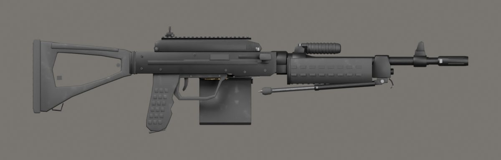

# İçe aktarma raporu: mg43

- Kaynak: `SourceAssets/Weapons/mg43/original/MG43.blend`
- Çıktı: `web/assets/weapons/mg43.glb` (1184 KB)
- Üçgen: 35992 → 35992
- Uygulanan ölçek: 1.000 (uzunluk 1.033 m → 1.033 m)
- Parçalar: gövde + charging, mag
- Doku: ayrı JPEG dosyaları (`web/assets/weapons/mg43_t*.jpg`; kaynak: T_Metal_BaseColor, T_Metal_Metal, T_Metal_Normal, T_Metal_Rough, T_Polymer_BaseColor, T_Polymer_Normal, T_Polymer_Rough)
- Oyun koordinatlarında noktalar: `{"muzzle": [0, 0.063, -0.706], "sight": [0, 0.1458, 0.002], "front": [0, 0.1062, -0.614], "leftHand": [0, -0.005, -0.371], "eject": [0.03, 0.045, -0.086]}`

