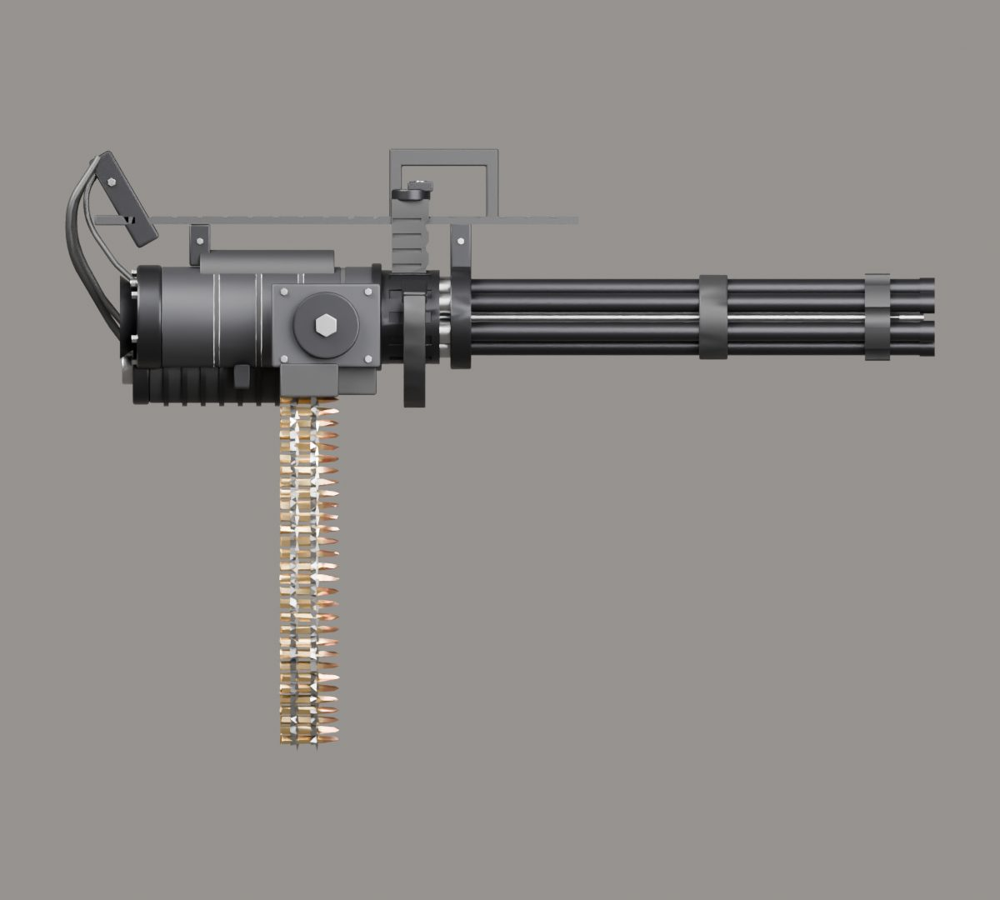

# İçe aktarma raporu: minigun

- Kaynak: `SourceAssets/Weapons/minigun/original/minigun_pro_5.blend`
- Çıktı: `web/assets/weapons/minigun.glb` (790 KB)
- Üçgen: 66980 → 25402
- Uygulanan ölçek: 0.968 (uzunluk 1.033 m → 1.000 m)
- Parçalar: gövde + mag, spin
- Doku: yok (yalnızca PBR renk malzemeleri)
- Oyun koordinatlarında noktalar: `{"muzzle": [0.0, -0.2178, -1.0262], "sight": [0.0, -0.092, -0.3388], "leftHand": [0.0, -0.0339, -0.455], "eject": [0.0581, -0.2904, -0.3485]}`

